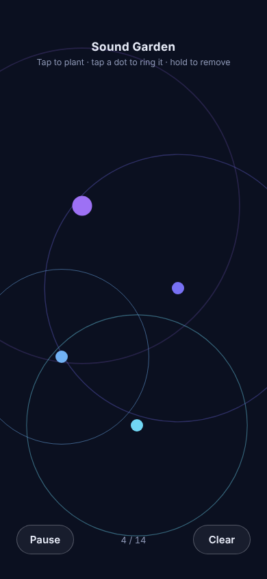

# Sound Garden

A slow, generative instrument for iOS and Android. Tap to plant dots. Each
dot rings a bell note and sends out a ripple, and when a ripple reaches
another dot, that dot answers with a quieter echo. Leave it alone and the
garden keeps playing by itself.



## How it plays

- **Tap empty ground** to plant a dot. Up to 14 fit.
- **Height sets the note.** Higher on the screen is a higher note. The ten
  notes are a pentatonic scale, so any combination sounds good together.
- **Left to right sets the tempo.** Each dot pulses by itself every few
  seconds, and dots further right pulse more slowly.
- **Ripples carry sound.** A ripple travels outward at a fixed speed. Each
  dot it reaches rings softly when the ripple arrives, so the distance
  between dots becomes rhythm.
- **Tap a dot** to ring it now. **Hold a dot** to pull it up.
- **Pause** stops the dots pulsing by themselves. **Clear** empties the garden.

## Run it

You need [Node.js](https://nodejs.org) 20 or later.

```bash
npm install
```

```bash
npx expo start
```

Then scan the QR code with the **Expo Go** app on an iPhone or Android
phone, or press `i` for the iOS simulator, `a` for an Android emulator, or
`w` for a web browser.

To make installable builds, use [EAS Build](https://docs.expo.dev/build/introduction/):

```bash
npx eas-cli build --platform all
```

## How it is built

One codebase in React Native with [Expo](https://expo.dev) (SDK 58), so the
same code runs on iOS, Android and the web.

| File | What is in it |
|---|---|
| `App.js` | The screen: touch handling, dots, ripples and buttons |
| `src/garden.js` | The rules: notes, tempo, ripple speed and reach |
| `src/sound.js` | Plays the bell tones with `expo-audio` |
| `scripts/make-tones.js` | Generates the ten bell tones in `assets/tones` |
| `scripts/make-icons.py` | Draws the app icons in `assets` |
| `scripts/test-garden.mjs` | Checks the rules in `src/garden.js` |

There is no animation loop checking for collisions. Ripples move at a
fixed speed, so when a dot pulses the app works out how long the ripple
takes to reach each neighbour and schedules the echoes for those moments.

The sounds and icons are generated by the scripts above, so everything in
the repo can be rebuilt from code:

```bash
npm run tones
```

```bash
npm run icons
```

```bash
npm test
```

## License

MIT. See [LICENSE](LICENSE).
